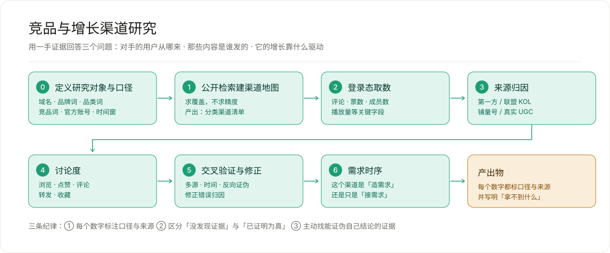

# competitive-research · 竞品与增长渠道研究

> **别的竞品分析工具帮你查数据。这个帮你判断哪些数据不能信。**

[](#安装)
[](LICENSE)



---

## 为什么它跟别的 skill 不一样

它不是"把公开资料整理一下"的包装。

它来自一次真实的全渠道拆解：**一个 AI 视频剪辑产品，20 个月，21 个平台，逐个渠道拿回一手数字。** 研究过程中翻的每一次车，都沉淀成了一条判据——所以这些判据不是推演出来的，是花钱买的。

| 当时看到的 | 实际是什么 |
|---|---|
| 两条 Product Hunt 好评**逐字相同** | 水军接了活、复制粘贴，**忘了删掉模板标记** |
| 两个账号（分别写过 30 条 / 51 条点评）**同时出现在当天 8 个上榜产品里的 6 个** | 横跨中国、美国、印度、德国团队 —— 这不是某国的打榜手法，是**平台级的付费服务** |
| Reddit 上 4 篇"真实用户体验" | **同一个模板**，3 个作者账号已被平台封禁 |
| 头条结论是"SEO 是它的增长引擎" | Google Trends 显示需求**连续 30 个月为 0**，而内容池早发了 9 个月；内容产出最多的那个月（48 篇）需求反而是全期最低（4）→ 结论推翻：**增长靠事件，留存靠内容池；SEO 是结果，不是原因** |

还有一个反直觉的：**评论/点赞比在数学上无法检测买票**。买票抬高的是分母，比值只会往下走——所以"比值正常"根本不能证明"票是真的"。这类陷阱，光看数字永远看不出来。

**它的产物不是"一份竞品报告"，而是一份每个数字都标了口径与来源、并且明确写出"拿不到什么"的报告。**

**它有一条硬规矩：宁可写"拿不到"，也不要估一个数填上。**

---

## 它具体能干什么

| 能力 | 说明 |
|---|---|
| **渠道地图** | 从公开检索建立分类渠道清单，不求精度求覆盖 |
| **登录态取数** | 持久化浏览器 profile，一次登录长期复用；17 个通用抓取器模板覆盖 21 个平台 |
| **来源归因** | 区分第一方 / 联盟 KOL / 平台备案商单 / 铺量号 / 真实 UGC |
| **操纵识别** | 三条硬判据（跨账号同类文本、账号被平台封禁、是否通用服务） |
| **需求时序** | Google Trends + sitemap + 社媒时间线三线对齐，判断渠道是"造需求"还是"接需求" |
| **口径纪律** | 九组判据，每条都对应一次真实误判 |

---

## 安装

### 方式一 · 从 Git 仓库导入（推荐）

```bash
/skills import https://github.com/sansan-debug/skill-competitive-research
```

### 方式二 · 本地文件夹

```bash
git clone https://github.com/sansan-debug/skill-competitive-research
/skills import ./skill-competitive-research
```

### 方式三 · 手动放置

```bash
cp -R skill-competitive-research ~/.workbuddy-ai/skills/competitive-research
```

装完用 `/skills` 查看列表。之后在对话里正常描述任务即可自动触发（描述里带"竞品研究 / 渠道归因 / 水军识别"等词）。

---

## 快速开始

```bash
cd ~/.workbuddy-ai/skills/competitive-research/scripts

npm i playwright-core     # 只依赖这一个包
npm run smoke             # 冒烟测试：确认 node / playwright / 端口都正常
npm run console           # 打开可见浏览器 + 本地面板，手动登录一次
```

登录态落在 profile 目录，**下次不用重复登录**。然后在另一个终端取数：

```bash
curl "http://127.0.0.1:8899/harvest-list"                        # 列出全部抓取器
curl "http://127.0.0.1:8899/harvest?id=probe_text&arg=<url>"      # 执行
```

> **开工前必做**：改 `scripts/config.js`（唯一需要按项目修改的文件），填研究对象、域名、品牌词变体、品类词、竞品、官方账号。

---

## 目录结构

```
.
├── SKILL.md                            # 入口：何时用、六阶段流程、抓取器索引
├── SECURITY.md                         # 安全披露：它做什么、有什么风险
├── references/
│   ├── workflow.md                     # 六阶段详细步骤 + 交付物验收清单
│   ├── verification-criteria.md        # ⭐ 九组判据（本 Skill 的核心价值）
│   ├── platform-recipes.md             # 21 个平台的接口路径与坑
│   └── pitfalls.md                     # 操作雷区 + 交付前自查
└── scripts/
    ├── config.js                       # 唯一需要按项目修改的文件
    ├── platforms.js                    # 登录哪些平台（含登录态判断字段）
    ├── login-console.js                # 可见浏览器 + 持久化 profile + 取数守护进程
    ├── harvest.js                      # 抓取器库：7 个基础设施 + 10 个技术模板
    ├── smoke.js                        # 环境冒烟测试
    └── package.json
```

---

## 环境要求

- **Node.js** ≥ 18（推荐 22+）
- **WorkBuddy 或 CodeBuddy 客户端**（Skill 宿主）
- 依赖：仅 `playwright-core` 一个包
- 平台：macOS / Linux / Windows

---

## 安全说明

**安装前请阅读 [`SECURITY.md`](SECURITY.md)。** 摘要：

- 静态审计已通过：无 `child_process` / `exec` / `spawn`、无 `eval`、无硬编码凭证
- HTTP 服务**只监听 `127.0.0.1`**，不对外暴露
- ⚠️ **profile 目录保存着各平台登录态** —— 泄露等于交出登录态，不要提交到 Git
- ⚠️ `json_via_fetch` 抓取器**会带着 Cookie 发请求** —— 不要把它指向陌生 URL
- ⚠️ 高频抓取会触发平台风控 —— 建议使用专门账号并控制请求间隔

**合规边界**：本 Skill 用于公开信息的采集与分析。使用者需自行遵守目标平台的服务条款、`robots.txt` 及相关法律法规，不得用于绕过访问控制或获取非公开数据。

---

## 三条不可违背的纪律

1. **每个数字标注口径与来源。** 同一个"声量"指标在不同口径下能差 50 倍；不写口径的数字没有意义。
2. **区分"没发现证据"与"已证明为真"。** 平台不公开的数据要写成"无法验证"，不能写成"已确认"。
3. **主动找能证伪自己结论的证据。** 每得出一个结论，先问"什么数据会让它不成立"。

---

## 作者

**搞开源运营的小肖** —— 做开源运营，顺手把踩过的坑沉淀成工具。

## License

[MIT](LICENSE)
